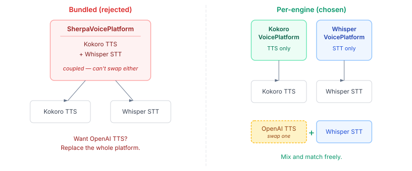
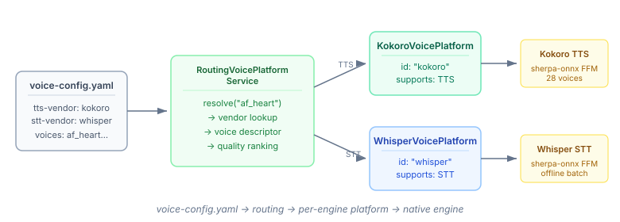

# Voice Providers That Compose

The voice infrastructure had a hole. We'd [moved the types into connectors](2026-11-01-mdp01-voice-where-it-belongs.md), unified the SPI, wired up playbook steps. The routing layer was built — `VoiceManifestLoader` with layered config, `RoutingVoicePlatformService` with voice resolution by name, alias, or attribute query. All plumbed. Nothing plugged in.

The `VoicePlatform` interface had two implementations: `ReferenceVoicePlatform` (canned strings, test only) and `NoOpVoicePlatform` (throws on everything). The actual engines — Kokoro TTS doing real synthesis via sherpa-onnx, Whisper doing real transcription — sat in voice-sherpa as standalone classes. The routing layer couldn't see them.

## The Obvious Wrong Answer

The reflex was a `SherpaVoicePlatform` that wraps both engines behind one `VoicePlatform`. Kokoro for TTS, Whisper for STT, bundled together, done.

I pushed back on that. A bundled platform couples two independent capabilities. What happens when you want OpenAI's TTS for high-quality narration but Whisper locally for transcription? Or Google Cloud STT for multilingual support with Kokoro staying local for synthesis? You're stuck — the platform is all-or-nothing.

The LLM manifest already solved this problem. `agent-config.yaml` doesn't bundle a single "LLM provider" — each provider is registered independently, and the routing picks the right one for each request. Voice should work the same way.



## One Platform Per Engine

Each engine gets its own `VoicePlatform` implementation. Single capability, single responsibility.

`KokoroVoicePlatform` implements `VoicePlatform` and does TTS only. It constructs a `KokoroTextToSpeech` from config, provisions the native library and model via `Provisioner`, and returns the engine from `textToSpeech()`. Call `speechToText()` and it throws `UnsupportedCapabilityException` — same pattern as `BankPlatform` where not every provider supports both AISP and PISP.

`WhisperVoicePlatform` is the mirror image. STT only, constructs `SherpaOnnxSpeechToText`, throws on `textToSpeech()`.

Both are `AutoCloseable` — they own the native FFM sessions and clean up on shutdown. Both have `withDefaults()` factories that auto-provision models. Both are plain Java — no CDI annotations, because voice-sherpa is a Java 22 FFM module that shouldn't depend on a container.

The `voice-config.yaml` (renamed from `seed-catalog.yaml` — "seed" already means something specific in this platform) declares both as separate providers:

```yaml
providers:
  - vendor: kokoro
  - vendor: whisper

defaults:
  tts-vendor: kokoro
  stt-vendor: whisper
```

The routing layer already had separate `tts-vendor` and `stt-vendor` fields in `VoiceManifestDefaults`. It was designed for mix-and-match from the start — we just hadn't built the pieces to plug in.



## Why This Architecture Matters

The per-engine model isn't just cleaner. It's what makes voice composable across providers, exactly the way LLM routing already works.

A deployment uses Kokoro locally for low-latency synthesis and Whisper locally for transcription. No cloud dependency, no API keys, everything runs on-device via sherpa-onnx FFM bindings. That's the default.

A different deployment swaps Kokoro for OpenAI TTS when narration quality matters — and keeps local Whisper for STT because latency and privacy are more important than multilingual accuracy. Each provider is a separate `VoicePlatform` bean. The manifest declares which one to use for TTS and which for STT. The routing layer does the dispatch. The playbook YAML doesn't change.

Adding a new provider means implementing `VoicePlatform` with one capability, registering it in the manifest, and the routing picks it up. No adapter layers, no bundling, no cross-capability coupling. The same extension model every other connector SPI uses — chat, bank, calendar, commerce, travel — now applies to voice.

The voice layer went from "standalone native code that happens to work" to a proper platform capability: manifest-routed, mix-and-match capable, and composable with everything else in the connector infrastructure.
